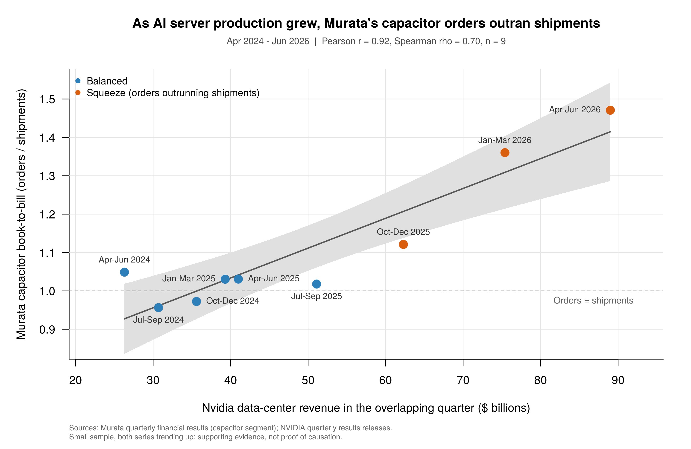

# AI Data Centers and Capacitor Availability

Has the AI data-center buildout tightened the supply of capacitors? This project compares **Murata's capacitor book-to-bill ratio** (orders received ÷ sales shipped) with **Nvidia's data-center revenue** by quarter, April 2024 to June 2026.



## Key findings

- **Strong association:** Pearson r = 0.92, Spearman ρ = 0.70 (n = 9 quarters).
- **Regression:** each additional $10B of Nvidia quarterly data-center revenue goes with about **+0.08** in Murata's capacitor book-to-bill (p < 0.001, R² = 0.85).
- **Timing:** orders and shipments were balanced through September 2025. After Nvidia's growth re-accelerated in late 2025, book-to-bill rose to **1.12 → 1.36 → 1.47**, and Murata's backlog grew from about 2 to 4.3 months of sales.
- **Availability before price:** Murata reported falling selling prices every quarter through June 2026 while availability tightened. Broad MLCC price increases appeared in mid-2026.

A full write-up with the data table, method and limitations is in [`docs/description.pdf`](docs/description.pdf) (LaTeX source: [`docs/description.tex`](docs/description.tex)).

## How to run

The script uses base R only, with no packages to install.

```r
source("murata_vs_nvidia_base.R")
```

It prints the correlations and regression summary and saves `murata_vs_nvidia_base.png`. To add a quarter, append one value to each vector at the top of the script and re-run.

## Data sources

- **Murata Manufacturing:** quarterly *Consolidated Financial Results*, capacitor segment orders and sales (millions of yen). https://corporate.murata.com/en-global/ir
- **NVIDIA:** quarterly results press releases, data-center revenue ($ billions). https://investor.nvidia.com

Each Murata quarter is paired with the Nvidia quarter that mostly overlaps it (Nvidia's quarters end about one month later). Some values are derived from reported cumulative totals or growth rates; see the comments in the script.

## Limitations

Nine quarters with both series trending upward: the results are evidence consistent with AI demand tightening capacitor availability, not proof of causation. Murata's figures are in yen, and other MLCC demand (autos, phones) also contributes.

## Author

Jack R. Chepin
